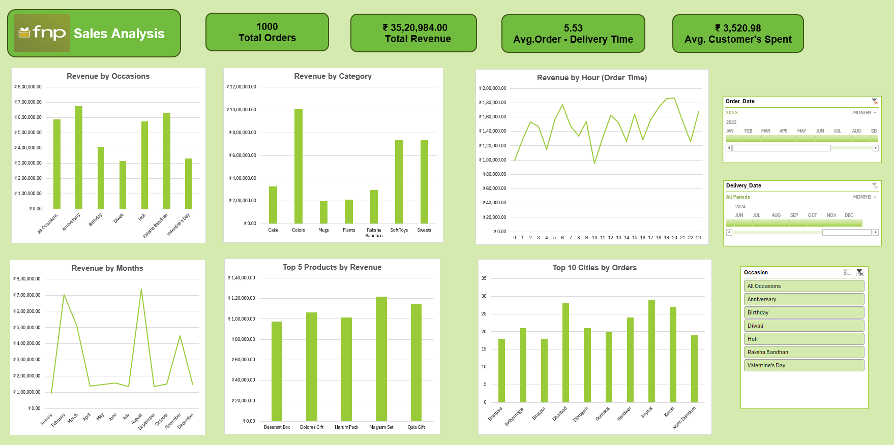

# 🎁 FNP-Sales-Analysis-Excel-Dashboard


An **end-to-end sales data analysis project** using Microsoft Excel to explore sales performance, customer spending, product trends, and delivery efficiency for **Ferns and Petals (FNP)**. The project uses data cleaning, data modeling, PivotTables, PivotCharts, and interactive dashboard features to generate meaningful business insights.

---

## 📌 Project Overview

Ferns and Petals (FNP) is a gifting company specializing in products for occasions such as Diwali, Raksha Bandhan, Holi, Valentine's Day, birthdays, and anniversaries.

The objective of this project is to analyze FNP's sales data to understand revenue trends, customer purchasing behaviour, product performance, and order delivery patterns.

An interactive Excel dashboard is developed to help visualize key performance indicators (KPIs), compare sales across different categories and occasions, and support business decision-making.

---

## 🎯 Problem Statement

The dataset contains information about products, orders, customers, and relevant dates. The goal is to analyze the data and answer key business questions to help FNP improve its sales strategy and customer satisfaction.

### Business Questions

| # | Business Question |
|---|---|
| 1 | What is the total revenue generated from sales? |
| 2 | What is the average time taken for orders to be delivered? |
| 3 | How does sales performance fluctuate across the months of 2023? |
| 4 | Which products generate the highest revenue? |
| 5 | What is the average spending per customer? |
| 6 | Which are the top 5 products based on revenue? |
| 7 | Which are the top 10 cities based on the number of orders? |
| 8 | Is there a relationship between order quantity and delivery time? |
| 9 | How does revenue compare across different occasions? |
| 10 | Which products are most popular during specific occasions? |

---

## 🏗️ Project Workflow

```text
        Raw Datasets
             |
     -------------------
     |        |        |
  Products  Orders  Customers
     |        |        |
     -------------------
             |
      Data Preparation
             |
      Data Modeling
             |
   -----------------------
   |          |          |
PivotTables  KPIs   Calculations
   |          |          |
   -----------------------
             |
       PivotCharts
             |
     Slicers & Timelines
             |
   Interactive Excel Dashboard
             |
       Business Insights
```

---

## 🗂️ Project Structure

```text
FNP-Sales-Analysis-Excel-Dashboard/
│
├── Dataset/
│   ├── Customers.csv
│   ├── Orders.csv
│   └── Products.csv
│
├── Dashboard.png
│
├── FNP_Sales_Analysis.xlsx
│
└── README.md
```

---

## 🔧 Tech Stack

| Technology | Purpose |
|---|---|
| Microsoft Excel | Data analysis and dashboard development |
| Power Query | Data cleaning and transformation |
| Power Pivot | Data modeling and calculated fields |
| PivotTables | Data summarization and aggregation |
| PivotCharts | Visual representation of sales data |
| Slicers & Timelines | Interactive data filtering |
| Excel Functions | Calculations and correlation analysis |

---

## 📊 Key Performance Indicators (KPIs)

The dashboard includes the following KPIs:

| KPI | Value |
|---|---:|
| Total Revenue | ₹35,20,984 |
| Total Orders | 1,000 |
| Average Order-to-Delivery Time | 5.53 Days |
| Average Customer Spending | ₹3,520.98 |

---

## 📈 Dashboard Visualizations

The interactive dashboard includes:

1. Revenue by Occasion
2. Revenue by Product Category
3. Revenue by Hour of Order
4. Revenue by Month
5. Top 5 Products by Revenue
6. Top 10 Cities by Number of Orders

### Dashboard Preview



---

## 🔍 Data Analysis

The project includes analysis of:

- Monthly revenue trends.
- Product-wise and category-wise sales performance.
- Customer spending patterns.
- City-wise order distribution.
- Revenue contribution across different occasions.
- Order quantity versus delivery time using correlation analysis.
- Product performance across different occasions using an Occasion slicer.

---

## 🧠 Key Insights

- Total revenue generated was **₹35,20,984** from **1,000 orders**.
- The average order-to-delivery time was approximately **5.53 days**.
- The Colors category generated the highest revenue among the product categories.
- Colors and Soft Toys were among the major revenue-generating products.
- Correlation analysis between order quantity and delivery time resulted in approximately **0.00348**, indicating almost no linear relationship between the two variables.
- Occasion-wise revenue analysis helps identify the contribution of different gifting occasions to overall sales.

---

## 🚀 How to Explore the Project

1. Download the Excel workbook from this repository.
2. Open `FNP_Sales_Analysis.xlsx` in Microsoft Excel.
3. Navigate to the Dashboard worksheet.
4. Use the Order Date and Delivery Date timelines to filter the data.
5. Use the Occasion slicer to explore sales performance across different occasions.
6. Explore the supporting worksheets and PivotTables for detailed analysis.

---

## 👩‍💻 Author

**Thuchanthini S**

[LinkedIn](https://www.linkedin.com/in/thuchanthinis/)
